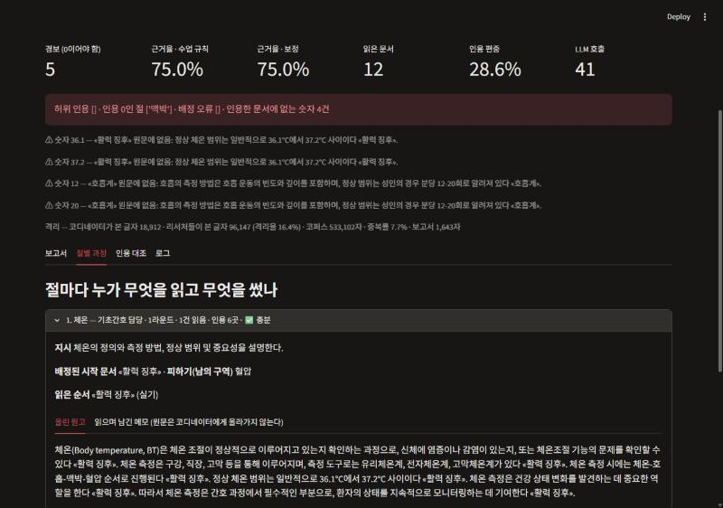

# 간호조무사 국가시험 딥리서처 (my-deep-researcher)

질문 하나를 넣으면 **코디네이터가 목차를 짜서 절마다 리서처 에이전트에게 맡기고**, 리서처들이 각자 맡은 문서만 읽어 쓴 원고를 이어 붙여 **문장마다 근거 문서가 붙은 학습 보고서**를 만든다.
코퍼스는 간호조무사 국가시험 4과목(기초간호학 개요 · 보건간호학 개요 · 공중보건학 개론 · 실기)에서 고른 한국어 위키백과 69건, 533,102자다. gpt-4o-mini 의 컨텍스트 창(128,000 토큰)의 2.5배라 한 번에 넣을 수 없다.

> 모두의연구소 AI에이전트 2기 · 「딥리서치 에이전트 만들기 [프로젝트]」 제출물. 설계와 결과는 [REPORT.md](REPORT.md), 요구사항은 [PRD.md](PRD.md).
> **연습용 자료다.** 의료 판단의 근거로 쓰지 말 것. 위키백과는 시험 출제 기준과 다를 수 있다.

## 실행

```bash
uv venv --python 3.12 .venv
uv pip install --python .venv/Scripts/python.exe -r requirements.txt     # macOS/Linux: .venv/bin/python
cp .env.example .env        # OPENAI_API_KEY 를 넣는다 (데모 열람만 할 거면 필요 없다)
```

| 하는 일 | 명령 | 키 |
|---|---|---|
| 데모 화면 (저장된 실행 열람 · 새 질문 실행) | `streamlit run app.py` | 열람은 불필요 |
| 코퍼스 다시 만들기 (`data/raw/` 캐시가 있으면 안 받는다) | `python data/build_corpus.py` | 불필요 |
| 질문 하나 실행 | `python graph.py "질문"` | 필요 |
| 대조군 하나 실행 | `python baseline.py 12 "질문"` | 필요 |
| 소거 실험 (기본 · 스위치 하나 끔 · 대조군 × 반복) | `python ablation.py --rep 2 --off 배정 재위임` | 필요 |
| 경보·배정 검사 테스트 (6개) | `python tests/test_checks.py` | 불필요 |
| 실험 기록 → 비교표 (REPORT 6장) | `python summarize.py` | 불필요 |

## 폴더

```
data/        corpus.json · meta.json(과목 · 출처 · 라이선스) · questions.json · build_corpus.py · raw/(API 응답 캐시)
config.json  절수 · 절예산 · 바퀴 상한 · 카드 길이 · 역할 명단 · 장치 스위치
graph.py     ① plan → ② dispatch(Send) → ③ researcher → ④ review ⇄ ② → ⑤ synthesize → ⑥ evaluate
metrics.py   정답표·판정 모델 없이 코드로 재는 지표
baseline.py  단일 에이전트 대조군 (같은 코퍼스 · 모델 · 도구 · 읽기 예산)
ablation.py  소거 실험 → output/
app.py       streamlit 데모
output/      실행 기록 JSON (_ 로 시작하는 것은 측정 전 확인 실행 로그와 비교표)
summarize.py output/ → 비교표
tests/       키 없이 도는 검사 (배정 검사 · 허위 인용 · 인용 0절 · 덮어쓰기 · 보정 근거율 · 지어낸 숫자)
docs/        데모 캡처
PRD.md · REPORT.md · 작업기록.md
```

## 화면



## 자료 출처와 라이선스

- 코퍼스 본문: [한국어 위키백과](https://ko.wikipedia.org), **CC BY-SA 4.0**. 문서마다 원문 주소는 `data/meta.json` 에 있다. 본문은 각주 이후를 자른 것 말고는 고치지 않았다.
- 시험 과목·문항 수는 학원·학습 사이트 안내를 따랐다(국시원 공식 공고는 확인하지 못함). 기출문제와 시판 교재는 쓰지 않았다.
- API 키는 저장소에 없다(`.env` 는 `.gitignore`).
