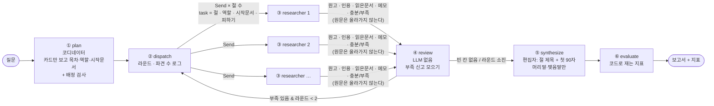
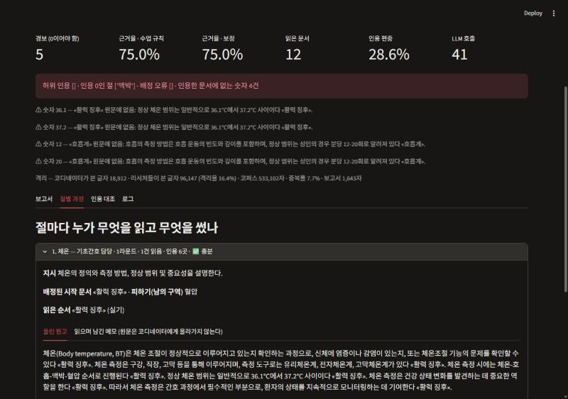

# REPORT — 간호조무사 국가시험 딥리서처

> 2026-11-06 · 모두의연구소 AI에이전트 2기 「딥리서치 에이전트 만들기 [프로젝트]」
> 모델 `gpt-4o-mini-2024-07-18` · LangGraph 1.2.20 · 표의 숫자는 모두 `output/` 파일에서 `summarize.py` 로 뽑았다.

## 1. 주제와 코퍼스

**왜 이 주제인가.** 간호조무사 국가시험은 4과목(기초간호학 개요 35 · 보건간호학 개요 15 · 공중보건학 개론 20 · 실기 35, 105문항 — 학원·학습 사이트 안내 기준, 국시원 공고는 확인 못 함)이다. 한 주제가 여러 과목에 흩어져 있다. 예를 들어 감염 예방은 기초간호(질환) · 실기(보호구 · 멸균) · 공중보건(감염병 · 예방접종)에 걸친다. 리서처 결과는 나중에 휴대폰용 문제집 HTML 의 재료가 된다(2단계, 이번 범위 밖).

**과제 조건을 숫자로 확인했다** (`python data/build_corpus.py` 출력)

| 조건 | 결과 |
|---|---|
| 자료 30건 이상 | **69건** (기초간호 25 · 보건간호 7 · 공중보건 19 · 실기 18) |
| 총량이 컨텍스트 창을 넘는다 | **533,102자 · 320,315 토큰**(o200k_base) = gpt-4o-mini 창 128,000 토큰의 **2.50배** |
| 자료끼리 서로 가리킨다 | 코퍼스 안 링크 **310개**. 그중 40개는 본문에 다른 문서 제목이 나와서 이은 것. 링크 0개 문서 2건(「단백질」「인구」 — 배정으로만 닿는다), 아무도 가리키지 않는 문서 8건 |

**모은 방법.** 한국어 위키백과 MediaWiki API · 과목별 시드 139개 · 각주 이후 자름(본문 문장은 고치지 않음) · 3,000자 미만 제외. 수업 프롬프트는 "시드에서 2홉"이었지만, 2홉으로 넓히면 시험 범위 밖(인물 · 지명)으로 번져 **과목별 시드를 직접 고르는 쪽**을 택했다.

**도메인 때문에 바꾼 규칙 둘**
- **실기만 최소 1,000자.** 한국어 위키의 술기 문서는 대부분 토막글이다(욕창 339자 · 소독 293자 · 손 씻기 621자 · 주사 416자). 3,000자 규칙으로는 실기가 4건뿐이었다. 기준을 낮춰도 총량 전제(창의 2.5배)는 그대로다.
- **공공문서는 이번에 빠졌다.** 국가건강정보포털은 글 주소로 직접 열면 첫 화면으로 돌려보낸다. 사이트 흐름을 우회하지 않고는 받을 수 없어 뺐다. 법령은 OC 인증키가 없어 뺐다. → **실기 · 보건간호의 깊이가 이 코퍼스의 가장 큰 한계다** (6장).

## 2. 질문 세트 (`data/questions.json`, 10건 · 정답표 없음)

| 유형 | 질문 | 이 구조를 쓸 이유 |
|---|---|---|
| 단일 | Q1 활력 징후 · Q2 B형 간염 전파 · Q9 국민건강보험 | **쓰면 안 되는 질문.** 문서 한 건이면 된다 — 리서처 넷이 낭비임을 보이려고 넣었다 |
| 다갈래 | Q3 감염 예방 · Q5 노인 건강 문제 · Q7 응급처치 · Q8 수인성 감염병 · Q10 모자보건 | 과목이 다른 문서들에 근거가 흩어져 있다 |
| 따라가기 | Q4 결핵 · Q6 당뇨병 합병증 | 한 대상을 따라 링크를 건너야 한다 |

질문마다 "왜 나눌 만한가"를 한 줄씩 적었다. **실험에는 Q1(단일) · Q5(다갈래) · Q6(따라가기)** 을 썼다. 처음엔 Q4 를 쓰려 했지만, 측정 전 확인 실행에서 인용이 «결핵» 한 건에 100% 몰렸다. 코퍼스에 결핵 문서가 한 건뿐이라 '따라가기'가 성립하지 않아 Q6 으로 바꿨다(`output/_smoke_Q4_4.txt`).

## 3. 분업 설계

| 결정 | 선택 | 이유 |
|---|---|---|
| 목차 기준 | **내용 단위**(질환 · 대상자 · 술기 · 제도) | 형식 단위(개요 · 정의 · 정리)로 나누면 리서처 전부가 같은 문서를 읽는다 |
| 역할 명단 | 큰그림 · 기초간호 · 보건간호 · 공중보건·법규 · 실기 절차 담당 | 시험 과목 = 읽는 관점. 실기 담당은 '준비 → 수행 → 마무리'와 금기를, 법규 담당은 수치·기준을 못 박는다 |
| 코디네이터가 보는 것 | 문서마다 `(과목) 제목: 앞 250자` 카드 | 원문은 안 본다. 카드 전체 약 18,900자 = 코퍼스의 3.5% |
| 배정 검사 | 시작 문서가 코퍼스에 없으면 **코드가 걸러 내고 `배정오류`로 기록**, 그 자리는 자율 | 첫 실행에서 모델이 `결핵 [공중보건학 개론]`을 제목으로 지어냈다. 수업 코드처럼 '맨 앞 문서'로 채우면 결핵 질문에 «간호»가 배정된다 |
| 남의 구역 | 다른 절의 시작 문서 + 이미 읽은 문서를 알려 준다 | 서로 못 보는 리서처가 같은 문서로 몰리지 않게 |
| 후보 넓히기 | 링크 후보에서 못 고르면 링크 밖 후보로 한 번 더(팀 · 대조군 같은 규칙) | 「결핵」은 「대한민국 질병관리청」을 링크하지 않는다 — 링크만 주면 법규 담당이 멈췄다 |
| 점검 신호 | 리서처의 자기신고(`충분`/`부족`), review 는 LLM 호출 없음 | 별도 호출 없이 무엇이 비었는지 문장으로 받는다 |
| 멈춤 | 빈 칸 없음 **또는** 2라운드 | 내용 기준과 횟수 기준을 둘 다 둔다 |
| 덮어쓰기 | 재위임 원고가 인용을 잃으면 옛 원고를 지킨다 | 인용을 빠뜨린 둘째 원고가 멀쩡한 첫 원고를 지우지 않게 |
| 종합 | 편집자는 절 제목 + 첫 90자만 보고 머리말·맺음말만 쓴다 | 본문을 다시 쓰면 격리가 깨지고 인용이 빠진다 |

설정은 모두 `config.json` 한 곳에 있다(절수 4 · 절예산 3 · 최대바퀴 2 · 카드 250자 · 스위치 넷).

## 4. 파이프라인 구조도

**State** (`graph.Research`): `question` · `plan`(목차 · 배치 · 바퀴 · 배정오류) · `sections`(리듀서 `operator.add` — 리서처가 올린 절) · `visited`(리듀서 — (절, 문서)) · `report` · `metrics` · `log`(리듀서) · `task`/`prior`(Send 로 리서처 하나에게만 가는 지시와 지난 라운드 원고).

## 5. 지표 (`metrics.py` — 정답표도 판정 모델도 없음)

| 지표 | 종류 | 보는 장치 | 한 줄 설명 |
|---|---|---|---|
| 허위 인용 | 경보 0 | ③ 조사 | 인용한 문서 − 실제로 읽은 문서 |
| 인용 0인 절 | 경보 0 | ③ 조사 · ① 배정 | 근거 없이 쓴(또는 비운) 절 |
| 배정 오류 | 경보 0 | ① 기획 | 코디네이터가 지어낸 시작 문서 제목 |
| **지어낸 숫자** | 경보 0 | ③ 조사(읽기 도구) | 인용 붙은 문장의 숫자가 그 인용 문서 원문에 없음 — **직접 읽은 뒤 더했다(7장)** |
| 근거율 / 보정 근거율 | 비교 | ③ · ⑤ | 인용 붙은 문장 비율. 보정은 마침표 뒤로 밀린 인용을 앞 문장에 붙인 값 |
| 인용편중 · 인용된 문서 수 | 비교 | ② 배치 | 한 문서에 몰렸나, 몇 문서가 실제로 쓰였나 |
| 중복률 | 비교 | ② 구역 | 리서처들이 같은 문서를 읽은 비율 |
| 격리율 · 코디네이터/리서처 본 글자 | 증명 | 전체 구조 | 코디네이터가 본 글자 / 전체가 본 글자 |
| 대조군 소진율 | 공정성 | `baseline.py` | 대조군이 예산을 다 썼나 |

- 집필 지시에 "인용을 마침표 앞에 붙여라"를 넣어 두 근거율이 거의 같아졌다. **이 지시 때문에 수업의 근거율 숫자와 직접 비교하면 안 된다.**
- 지표는 명백한 실패를 거르는 데만 쓴다. 우열은 7장에서 직접 읽어 정한다.

## 6. 실험 결과

질문 3개(단일 · 다갈래 · 따라가기) × 설정 4개(기본 · 배정 끔 · 재위임 끔 · 단일 에이전트) × **2회** = 24번 (`python ablation.py --rep 2 --off 배정 재위임`). 기록은 `output/Q*_*.json` 이다.

### Q1 (단일) 활력 징후에는 무엇이 있고, 각각 무엇을 재는가?

| 설정 | 경보 (허위·인용0절·배정오류·지어낸숫자) | 근거율 % | 읽은 문서 | 인용된 문서 수 | 편중 % | 중복 % | 보고서 자 | LLM 호출 | 격리율 % | 대조군 소진율 |
|---|---|---|---|---|---|---|---|---|---|---|
| 기본 | 0·1·0·4 / 0·1·0·2 | 75 / 74.1 (평균 74.5) | 12 / 11 (평균 11.5) | 4 / 4 (평균 4.0) | 28.6 / 30 (평균 29.3) | 7.7 / 15.4 (평균 11.6) | 1643 / 1570 (평균 1606.5) | 41 / 41 (평균 41.0) | 16.4 / 18.5 (평균 17.4) | - |
| 배정끔 | 0·1·0·0 / 0·1·0·0 | 77.4 / 62.5 (평균 70.0) | 9 / 9 (평균 9.0) | 4 / 4 (평균 4.0) | 29.2 / 35 (평균 32.1) | 10 / 10 (평균 10.0) | 1767 / 1878 (평균 1822.5) | 33 / 33 (평균 33.0) | 20.6 / 25.7 (평균 23.1) | - |
| 재위임끔 | 0·1·0·2 / 0·1·0·2 | 74.1 / 76.7 (평균 75.4) | 6 / 6 (평균 6.0) | 4 / 4 (평균 4.0) | 30 / 26.1 (평균 28.1) | 25 / 25 (평균 25.0) | 1600 / 1706 (평균 1653.0) | 25 / 25 (평균 25.0) | 24.7 / 24.7 (평균 24.7) | - |
| 단일 | 0·0·0·4 / 0·0·0·0 | 83.3 / 50 (평균 66.7) | 12 / 11 (평균 11.5) | 3 / 4 (평균 3.5) | 80 / 33.3 (평균 56.6) | 0 / 0 (평균 0.0) | 1879 / 1480 (평균 1679.5) | 26 / 24 (평균 25.0) | 8.7 / 9 (평균 8.8) | 100% / 100% |

### Q5 (다갈래) 노인 대상자에게 흔한 건강 문제(치매, 파킨슨병, 골다공증, 낙상, 우울)는 무엇이고 각각 간호와 예방의 핵심은 무엇인가?

| 설정 | 경보 (허위·인용0절·배정오류·지어낸숫자) | 근거율 % | 읽은 문서 | 인용된 문서 수 | 편중 % | 중복 % | 보고서 자 | LLM 호출 | 격리율 % | 대조군 소진율 |
|---|---|---|---|---|---|---|---|---|---|---|
| 기본 | 0·0·0·0 / 0·0·0·0 | 76.7 / 76.7 (평균 76.7) | 12 / 12 (평균 12.0) | 6 / 6 (평균 6.0) | 18.2 / 18.2 (평균 18.2) | 29.4 / 29.4 (평균 29.4) | 2355 / 2401 (평균 2378.0) | 47 / 47 (평균 47.0) | 11 / 11 (평균 11.0) | - |
| 배정끔 | 0·0·0·0 / 0·0·0·0 | 76.7 / 76.7 (평균 76.7) | 13 / 12 (평균 12.5) | 6 / 6 (평균 6.0) | 18.2 / 21.2 (평균 19.7) | 35 / 29.4 (평균 32.2) | 2369 / 2444 (평균 2406.5) | 59 / 51 (평균 55.0) | 9.1 / 10.6 (평균 9.8) | - |
| 재위임끔 | 0·0·0·0 / 0·0·0·0 | 74.4 / 73.5 (평균 74.0) | 7 / 9 (평균 8.0) | 5 / 4 (평균 4.5) | 20.7 / 28 (평균 24.4) | 36.4 / 18.2 (평균 27.3) | 2059 / 1905 (평균 1982.0) | 33 / 32 (평균 32.5) | 14.7 / 14.7 (평균 14.7) | - |
| 단일 | 1·0·0·0 / 1·0·0·0 | 47.8 / 34.6 (평균 41.2) | 12 / 12 (평균 12.0) | 3 / 2 (평균 2.5) | 35.7 / 54.5 (평균 45.1) | 0 / 0 (평균 0.0) | 1110 / 1348 (평균 1229.0) | 25 / 25 (평균 25.0) | 5.2 / 5.2 (평균 5.2) | 100% / 100% |

### Q6 (따라가기) 당뇨병은 어떤 합병증으로 이어지고, 고혈압·뇌졸중·심장 질환과는 어떻게 연결되는가?

| 설정 | 경보 (허위·인용0절·배정오류·지어낸숫자) | 근거율 % | 읽은 문서 | 인용된 문서 수 | 편중 % | 중복 % | 보고서 자 | LLM 호출 | 격리율 % | 대조군 소진율 |
|---|---|---|---|---|---|---|---|---|---|---|
| 기본 | 0·0·0·0 / 0·0·0·0 | 71.8 / 71.1 (평균 71.4) | 12 / 14 (평균 13.0) | 3 / 3 (평균 3.0) | 57.1 / 55.6 (평균 56.4) | 7.7 / 12.5 (평균 10.1) | 2036 / 2068 (평균 2052.0) | 32 / 39 (평균 35.5) | 15.7 / 13.6 (평균 14.6) | - |
| 배정끔 | 0·0·0·0 / 0·0·0·0 | 72.1 / 75 (평균 73.5) | 5 / 4 (평균 4.5) | 4 / 3 (평균 3.5) | 61.3 / 75.8 (평균 68.5) | 50 / 60 (평균 55.0) | 2245 / 2405 (평균 2325.0) | 30 / 29 (평균 29.5) | 15.4 / 14.6 (평균 15.0) | - |
| 재위임끔 | 0·0·0·0 / 0·0·0·0 | 72.5 / 74.4 (평균 73.5) | 9 / 8 (평균 8.5) | 3 / 3 (평균 3.0) | 58.6 / 65.6 (평균 62.1) | 10 / 20 (평균 15.0) | 2125 / 2298 (평균 2211.5) | 25 / 26 (평균 25.5) | 18.5 / 17.2 (평균 17.9) | - |
| 단일 | 0·0·0·0 / 0·0·0·0 | 14.3 / 78.9 (평균 46.6) | 12 / 14 (평균 13.0) | 3 / 3 (평균 3.0) | 50 / 42.1 (평균 46.0) | 0 / 0 (평균 0.0) | 1450 / 1243 (평균 1346.5) | 25 / 29 (평균 27.0) | 7.9 / 7.4 (평균 7.7) | 100% / 100% |

값은 `1회 / 2회 (평균)`. 경보는 반복마다 `허위·인용0절·배정오류·지어낸숫자` 개수.

**대조군은 공정했다.** 단일 에이전트는 매번 '그 반복에서 팀이 실제로 읽은 문서 수'만큼 예산을 받았고, **6번 모두 소진율 100%** 였다. 같은 코퍼스 · 모델 · 도구(읽기 · 고르기) · 후보 규칙을 썼다.

**반복 두 번이 같은 방향을 가리킨 것만 결과로 적는다.**

1. **다갈래(Q5)에서는 팀이 분명히 낫다.**
   - 인용된 문서 수가 6 · 6 대 3 · 2, 근거율이 76.7 · 76.7% 대 47.8 · 34.6% 다.
   - 대조군은 **두 번 다 허위 인용 1건**이 나왔다. 「골다공증」을 읽지 않고 인용했다 — 질문에 이름이 나오니 읽은 척 쓴 것이다.
2. **따라가기(Q6)에서 가장 값을 한 장치는 ① 배정이다.**
   - 배정을 끄면 읽은 문서가 12 · 14건에서 5 · 4건으로 줄고, 중복률이 7.7 · 12.5% 에서 **50 · 60%** 로 뛴다. 시작 문서가 없으면 리서처 넷이 모두 「당뇨병」부터 읽기 때문이다.
   - 그런데 **근거율은 오히려 비슷하거나 높다**(72.1 · 75%). 근거율만 봤으면 이 차이를 놓쳤다. 적게 읽고 그 몇 건을 반복 인용해도 근거율은 높게 나온다.
3. **단일 질문(Q1)에는 이 구조를 쓰면 안 된다.**
   - 팀은 모든 설정·반복에서 **인용 0인 절이 1개** 나왔다. 「맥박」 절인데, 코퍼스에 맥박 문서가 없다(949자로 탈락).
   - LLM 호출은 41회로 대조군(24~26회)보다 많았다. 질문 세트에 '쓰면 안 되는 질문'으로 넣은 판단이 숫자로도 맞았다.
4. **재위임은 비용만 확실히 보인다.** 끄면 LLM 호출이 28~39%(Q5 47 → 33 · 32회), 읽은 문서가 33~48% 줄었다. 근거율 차이는 반복 사이 흔들림(Q1 배정 끔 77.4 대 62.5) 안쪽이다. 이 코퍼스에서는 재위임의 효과가 지표로 보이지 않는다 — 수업 결론과 같다.
5. **Q5 에서 배정을 꺼도 기본과 거의 같았다.** 질문이 문서 이름(치매 · 파킨슨병 · 골다공증 · 낙상)을 그대로 말해서, 리서처가 배정 없이도 그 문서를 찾아간다. 배정의 값은 질문이 문서 이름을 말하지 않을 때(Q6) 드러난다.
6. **격리** — 코디네이터가 본 글자는 실행마다 약 1만 9천 자(카드 + 절 첫머리)다. 리서처들이 본 글자는 5만 5천~19만 자다(`output/` 기록 18건의 최소·최대). 격리율 9~26% 는 코디네이터가 원문 대신 카드만 봤다는 뜻이다.

**한계** — 반복이 두 번뿐이다. 대조군 근거율은 Q6 에서 14.3% 대 78.9% 로 흔들렸다. 1회차는 '문장마다 인용' 지시를 어기고 문단마다 「«X»에 따르면」 한 번만 붙였다. 위 1~3번처럼 두 번 다 같은 방향인 것만 믿고, 몇 %p 차이로 순위를 매기지 않는다.

## 7. 직접 읽기

### 7-1. 나란히 읽기 — Q5 팀(기본 1회) vs 단일 에이전트(1회)

**팀이 낫다.** 두 보고서를 좌우로 놓고 읽은 판단과 이유다(데모의 '나란히 읽기' 탭).

- **팀 쪽 근거가 구체적이다.**
  - 절마다 그 질환 문서를 시작 문서로 받아 읽었다(치매 → «치매», 골다공증 → «골다공증»).
  - 그래서 "T-점수 -2.5 이하", "65세 이상 노인 중 3분의 1 이상이 연간 한 번 이상 낙상" 처럼 원문에 있는 숫자와 정의가 들어갔다. 시험에 나올 만한 문장이다.
- **단일 에이전트는 사전 지식에 인용 표시만 붙였다.**
  - 「파킨슨병」을 읽고 메모에 '관련 없음'이라고 적었다. 그런데 "파킨슨병에 대한 정보는 제공되지 않았지만…"으로 시작하는 문장 4개에 «파킨슨병»을 붙였다.
  - 골다공증 절 5문장은 읽지도 않은 «골다공증»을 인용했다.
  - 우울증 절은 코퍼스에 없는 «우울»을 인용했다.
  - 질문 하나 전체를 지시로 들고 12건을 읽다 보니, 한 질환만 다룬 문서는 '관련 없음'으로 버려졌다.
- **팀의 약점**
  - 간호 문장 5개를 일반론 문서 «간호»에 붙였다(오귀속, 7-2 ④).
  - 넷째 절이 「낙상과 우울」로 두 주제를 묶었다.
  - **네 절 모두 '기초간호 담당'** 이었다. 역할 명단을 만들었지만 코디네이터가 역할을 고르게 나누지 않았고, 이 질문에서는 역할 장치가 일하지 않았다.

### 7-2. 인용 대조 — 지표를 모두 통과했지만 틀린 문장

| # | 실행 | 문장(요약) | 원문 확인 | 지표 |
|---|---|---|---|---|
| ① | Q1 팀 기본 1 | "성인 정상 호흡 분당 12-20회" «호흡계» | 「호흡계」에 '12' · '분당' 없음 — **지어냄** | 허위 0 · 근거 붙음 → 통과. 지어낸 숫자 경보가 잡음 |
| ② | Q1 팀 기본 1 / 단일 1 | 정상 체온 "36.1~37.2°C"(팀) · "36.5~37.5도"(단일) «활력 징후» | 「활력 징후」에 정상 체온 수치 없음 — **둘 다 지어냈고 숫자도 서로 다르다** | 지어낸 숫자 경보가 잡음 |
| ③ | Q1 팀 기본 1 | "가정에서의 정상 혈압 수치는 135/80mmHg 이상으로 정의" «고혈압» | 원문: "135/80mmHg 이상을 **고혈압**으로 정의" — **뜻이 뒤집힘** | 숫자가 원문에 있어 **모든 지표 통과** |
| ④ | Q5 팀 기본 1 | "치매 환자의 안전을 확보하고 자립성을 유지…" 등 5문장 «간호» | 「간호」(5,572자)에 치매 · 안전 · 자립 · 정서 · 물리치료가 한 번도 안 나온다 — **오귀속** | 모든 지표 통과 |
| ⑤ | Q5 단일 1 | 파킨슨병 절 4문장 «파킨슨병» | 그 문서를 읽은 메모가 '관련 없음' — 문장은 사전 지식 | 읽은 문서라 허위 인용 아님 → 통과 |

**틀린 내용은 어디서 들어왔나.** ①②③ 은 원고를 쓸 때가 아니라 **읽기 도구(`read_one`)가 원문을 여섯 문장으로 간추린 메모**에 이미 들어 있었다. 필자는 메모를 충실히 옮겼다. 그래서 고칠 곳은 집필 지시가 아니라 읽기 도구다(9장).

**이걸 보고 더한 지표** — '지어낸 숫자'(인용 붙은 문장의 숫자가 그 인용 문서 원문에 없음). ①② 를 잡고, 24번 실험 중 Q1 에서만 나왔다(팀 기본 4 · 2, 재위임 끔 2 · 2, 단일 4 · 0). ③ 처럼 원문 숫자를 뜻을 뒤집어 붙인 것과 ④⑤ 는 여전히 **사람만 잡는다.**

## 8. 데모 설계 (`streamlit run app.py`)

- **저장된 실행** — 키 없이 열린다. 상단에 경보(0이어야 함) · 근거율 · 읽은 문서 · 편중 · LLM 호출과 격리 숫자. 아래 탭 넷:
  - **보고서**
  - **절별 과정** — 절마다 역할 · 라운드 · 배정된 시작 문서 · 피하기(남의 구역) · 읽은 순서(과목 표시) · 리서처 메모 · 올린 원고 · 자기신고. **"누가 무엇을 읽고 무엇을 썼나"가 이 화면의 요점이다.**
  - **인용 대조** — 인용 붙은 문장을 하나씩 넘기며 그 문서의 리서처 메모와 원문 앞부분을 나란히 본다.
  - **로그**
- **나란히 읽기** — 두 실행(예: 팀 기본 vs 단일 에이전트)의 보고서를 좌우로.
- **새 질문 실행** — `.env` 에 키가 있으면 질문 세트에서 고르거나 직접 써서 돌린다(약 1분). 결과는 `output/live_*.json` 으로 남는다.
- **코퍼스** — 문서마다 과목 · 글자 수 · 나가는/들어오는 링크 · 출처.
- 지어낸 숫자 경보는 저장된 보고서에서 화면이 다시 잰다(실험 도중 더한 지표라서).

## 9. 회고

**배운 것**
- **나눌 이유는 질문이 정한다.** 같은 구조가 다갈래(Q5)에선 대조군을 확실히 이겼다. 단일 질문(Q1)에선 빈 절과 호출 낭비만 남겼다. 질문 세트에 "왜 나눌 만한가"를 한 줄씩 적은 게 결과 해석의 기준이 됐다.
- **장치의 값은 그 장치를 보는 지표에서만 보인다.** 배정을 끈 효과는 근거율이 아니라 읽은 문서 수와 중복률에서 드러났다(Q6). 지표마다 '보는 장치'를 적어 둔 덕에 어디를 봐야 할지 알았다.
- **자동 지표는 '읽지 않은 문서 인용'까지만 잡는다.** 시험 대비 자료에서 가장 위험한 것(지어낸 정상 범위 · 뒤집힌 기준)은 허위 인용 0 인 보고서 안에 있었다. 직접 대조해야 보였고, 그중 숫자만 코드로 옮길 수 있었다.
- **수업 코드의 기본값이 도메인에서 깨졌다.** 후보 60건 상한, 배정 실패 시 '맨 앞 문서', 링크만 보는 후보 — 근대사 34건에선 문제가 없었지만 69건 · 링크가 성긴 위키에선 리서처를 멈추게 했다.

**한계**
- **코퍼스 깊이.**
  - 한국어 위키는 시험 출제 깊이가 아니다. 맥박 · 욕창 · 투약 문서가 없거나 토막글이다.
  - 「간호」는 일반론뿐이다. 그래서 간호 문장이 그 문서로 오귀속됐다.
  - 결핵처럼 한 주제에 문서가 하나면 '따라가기'가 성립하지 않는다.
- **반복 2회.** 방향이 두 번 다 같은 것만 결론으로 적었다. 대조군의 지시 이행이 크게 흔들려(Q6 근거율 14.3 대 78.9%) 더 많이 돌려야 한다.
- **역할 장치는 일하지 않았다.** Q5 에서 네 절이 모두 '기초간호 담당'이었다. 역할 스위치는 이번에 끄지 않았다.

**다음에 할 것**
1. **코퍼스 보강** — 법령(OC 키 발급 뒤)과 공공기관 지침. 실기 · 보건간호의 깊이를 채운다.
2. **읽기 도구 고치기** — 메모에 원문 문장을 그대로 따오게 하고(인용 구간 표시), 메모 단계에서 '지어낸 숫자' 검사를 돌린다. 틀린 내용이 들어오는 곳이 거기다.
3. **2단계 문제집 HTML 의 조건** — 문항마다 근거 원문 문장을 함께 싣는다. '지어낸 숫자' 0 인 문장만 문항으로 쓰고, 사람이 원문과 대조해 검수 표시를 단다.
